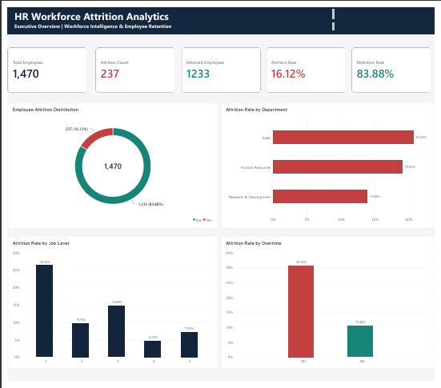
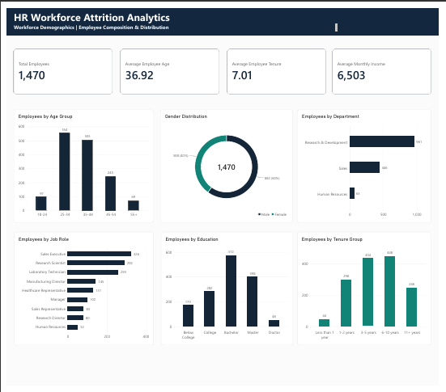
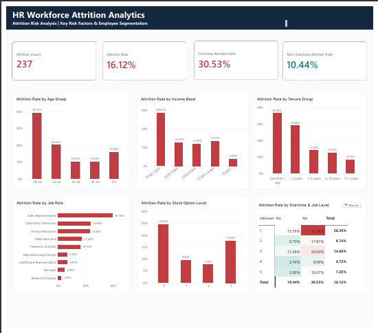
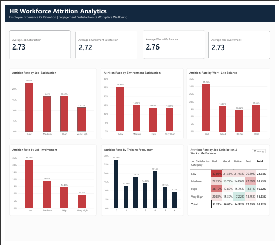

# HR Workforce Attrition Analytics

## Project Overview

This end-to-end Business Intelligence and HR Analytics project examines employee attrition, workforce demographics, employee engagement, and retention patterns across a dataset of 1,470 employees.

The project integrates Microsoft Excel, SQL, SQLite, Power Query, DAX, and Power BI to transform workforce data into actionable business insights that support evidence-based HR decision-making and employee retention strategies.

## Dataset Source and Licensing

This project utilizes the IBM HR Analytics Employee Attrition & Performance dataset, a fictional dataset created by IBM data scientists for analytical and educational purposes.

- **Original creator:** IBM data scientists
- **Source platform:** Kaggle
- **Dataset:** [IBM HR Analytics Employee Attrition & Performance](https://www.kaggle.com/datasets/pavansubhasht/ibm-hr-analytics-attrition-dataset)
- **Original records:** 1,470 employees
- **Original variables:** 35
- **Database license:** [Open Database License (ODbL) v1.0](https://opendatacommons.org/licenses/odbl/1-0/)
- **Contents license:** [Database Contents License (DbCL) v1.0](https://opendatacommons.org/licenses/dbcl/1-0/)

The dataset was cleaned, transformed, and enriched with analytical variables as part of this independent portfolio project. The original and derived databases are made available subject to the applicable dataset licenses.

The findings relate to fictional employee records and do not represent actual IBM workforce statistics.

## Business Objectives

- Identify employee segments with elevated attrition rates.
- Evaluate relationships between compensation, overtime, tenure, and employee turnover.
- Analyze workforce demographics and organizational composition.
- Assess employee satisfaction, engagement, and work-life balance.
- Develop actionable recommendations to strengthen employee retention.
- Deliver an interactive business intelligence reporting solution.

## Tools and Technologies

| Tool | Application |
|---|---|
| Microsoft Excel | Data cleaning, preparation, validation, and documentation |
| SQLite | Relational database management |
| SQL | Exploratory analysis, employee segmentation, and advanced analytical queries |
| Power Query | Data transformation and quality profiling |
| DAX | KPI development, calculated columns, and analytical measures |
| Power BI | Interactive reporting and data visualization |
| GitHub | Project documentation and portfolio presentation |

## Project Workflow

1. Data collection and understanding
2. Data cleaning and preparation
3. Data dictionary development
4. Data quality assessment
5. SQLite database implementation
6. SQL exploratory and advanced analysis
7. Power Query validation
8. DAX measures and calculated columns
9. Interactive dashboard development
10. Business interpretation and strategic recommendations

## Key Performance Indicators

| Metric | Result |
|---|---:|
| Total Employees | 1,470 |
| Departed Employees | 237 |
| Retained Employees | 1,233 |
| Overall Attrition Rate | 16.12% |
| Retention Rate | 83.88% |
| Average Employee Age | 36.92 years |
| Average Employee Tenure | 7.01 years |
| Average Monthly Income | 6,503 |
| Overtime Attrition Rate | 30.53% |
| Non-Overtime Attrition Rate | 10.44% |

## Interactive Power BI Dashboards

### 1. Executive Overview

Provides a high-level view of workforce performance, employee attrition, retention, departmental differences, job levels, and overtime exposure.

### 2. Workforce Demographics

Examines employee composition across age groups, gender, departments, job roles, education levels, income, and organizational tenure.

### 3. Attrition Risk Analysis

Identifies employee segments with elevated historical attrition rates through age, compensation, tenure, job role, stock options, and combined overtime and job-level analysis.

### 4. Employee Experience & Retention

Evaluates employee satisfaction, workplace environment, work-life balance, job involvement, training frequency, and combined employee experience indicators.

## Key Business Findings

- Employees working overtime recorded an attrition rate of 30.53%, compared with 10.44% among employees not working overtime.
- Sales recorded the highest departmental attrition rate at 20.63%, followed by Human Resources at 19.05%.
- Sales Representatives recorded an attrition rate of approximately 39.76%, the highest among job roles.
- Job Level 1 employees working overtime recorded an attrition rate of 52.56%.
- Employees earning under 3,000 per month with less than one year of tenure recorded an attrition rate of 45.83%.
- Employees without stock options recorded an attrition rate of 24.41%.
- Employees reporting low job satisfaction recorded an attrition rate of 22.84%.
- Employees reporting high job satisfaction but poor work-life balance recorded an attrition rate of 38.10%.
- Departed employees earned an average monthly income of 4,787.09, compared with 6,832.74 among retained employees.

## Strategic Business Recommendations

### Workforce Planning and Workload Management

Review overtime allocation, staffing capacity, workload distribution, and scheduling practices, particularly within Sales and entry-level positions.

### Compensation and Employee Benefits

Evaluate compensation competitiveness, salary progression, stock option eligibility, and employee recognition programs.

### Early-Tenure Employee Retention

Strengthen onboarding, mentoring, career development, and structured employee check-ins during the early stages of employment.

### Employee Engagement and Wellbeing

Implement regular employee feedback mechanisms, workplace satisfaction assessments, and work-life balance initiatives.

### Continuous HR Performance Monitoring

Establish recurring HR analytics reporting to monitor attrition patterns, evaluate retention initiatives, and support proactive workforce planning.

## SQL Analysis

The SQL analysis demonstrates practical application of:

- Aggregate functions
- Conditional aggregation
- CASE expressions
- Common Table Expressions (CTEs)
- Subqueries
- Window functions
- DENSE_RANK()
- Employee segmentation
- Comparative workforce analysis
- Data integrity and validation checks

The final SQL validation returned a PASS status, confirming 1,470 unique employee identifiers, consistent attrition indicators, and reconciled workforce totals.

## Data Quality and Validation

| Validation Check | Result |
|---|---|
| Total employee records | 1,470 |
| Unique employee identifiers | 1,470 |
| Duplicate employee identifier discrepancy | 0 |
| Invalid attrition flags | 0 |
| Inconsistent attrition flags | 0 |
| Final SQL validation | PASS |

## Project Files

- **data/** — Original HR dataset and cleaned employee dataset.
- **excel/** — Excel data preparation workbook, data dictionary, and data quality checks.
- **sql/** — SQL analytical script and SQLite database.
- **powerbi/** — Interactive four-page Power BI report.
- **images/** — Dashboard screenshots.
- **documentation/** — Business insights and strategic recommendations.

## Business Insights Report

[Download the Business Insights and Recommendations Report](documentation/Business_Insights_and_Recommendations.pdf)

## Analytical Limitations

This project uses descriptive and exploratory analytics. Identified relationships represent observed associations rather than established causal relationships.

Employee segments with smaller populations should be interpreted cautiously. Additional longitudinal data, employee exit interviews, and organizational context would strengthen future analysis.

## Future Enhancements

- Predictive employee attrition modeling using Python.
- Statistical analysis of potential attrition factors.
- Automated data refresh and reporting pipelines.
- Time-series workforce analysis using historical HR records.
- Evaluation of employee retention initiatives.

## Skills Demonstrated

Business Intelligence | Data Analytics | HR Analytics | SQL | SQLite | Microsoft Excel | Power BI | Power Query | DAX | Data Cleaning | Data Validation | Data Visualization | Exploratory Data Analysis | KPI Development | Business Reporting | Strategic Decision-Making

## Author

**Vanessa Polson**

Business Intelligence & Data Analytics | Business Operations | Process Improvement | Data-Driven Decision-Making

[Connect with me on LinkedIn](https://www.linkedin.com/in/vanessapolson-jm)

---

*This project was developed for professional portfolio and educational purposes, demonstrating an end-to-end approach to workforce analytics and business intelligence.*
